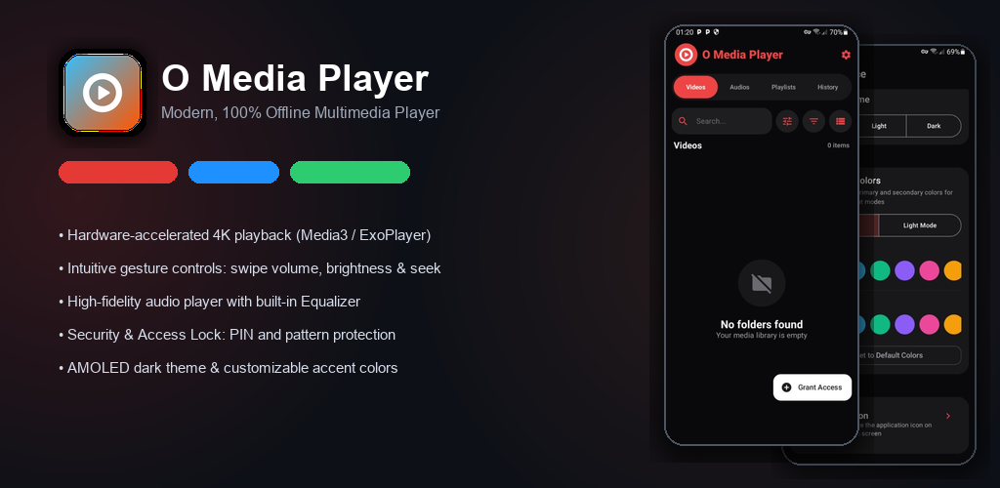
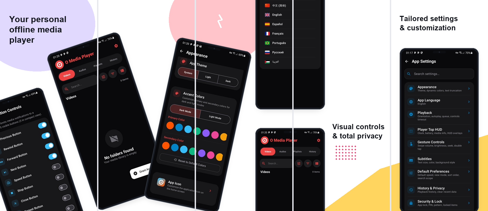

# O Media Player

<p align="center">
  
</p>

<p align="center">
  <a href="https://www.android.com/"></a>
  <a href="https://www.gnu.org/licenses/gpl-3.0"></a>
  <a href="https://github.com/mohamedaminelouati/O-Media-Player/releases/latest"></a>
  <a href="https://f-droid.org/packages/com.mohamedaminelouati.oplayer/"></a>
</p>

**O Media Player** is an intuitive, modern, 100% offline, privacy-first multimedia player for Android featuring a powerful video player, high-fidelity music player, and customizable security access lock.

Developed & Maintained by **[Mohamed Amine Louati](https://mohamedaminelouati.pro/)**.

---

## 📱 Screenshots

<p align="center">
  
</p>

---

## 🌟 Key Features

- **100% Offline & Private (Zero-Knowledge)**: Complete local privacy. No internet permission, zero ads, and zero background trackers.
- **Hardware-Accelerated Video Playback**: High-performance playback engine powered by AndroidX Media3 / ExoPlayer with support for smart buffering, Picture-in-Picture (PiP), aspect ratio switching (Fit, Stretch, Zoom), and background audio playback.
- **Intuitive Gesture Controls**:
  - **Left swipe**: Brightness control
  - **Right swipe**: Volume control
  - **Horizontal swipe**: Accurate seeking
  - **Double-tap**: Fast forward / rewind
- **Premium Music Experience**:
  - Built-in multi-band Equalizer with bass boost and virtualizer.
  - Repeat modes (Off, All, One) and flexible shuffle algorithms.
  - Configurable sleep timer and custom notification controls.
- **Pure Dark & AMOLED Modes**: Modern Material 3 UI with customizable primary and secondary accent color palettes.
- **Dynamic App Icon Customization**: Choose from multiple dual-color launcher icon styles directly within the app.
- **Background Playback & PiP**: Keep enjoying your media with Picture-in-Picture (PiP) multitasking and background audio playback with screen-off support.
- **Security & Access Lock (PIN / Pattern)**: Secure app access, sensitive folders, and media playback with PIN or Pattern protection.
- **Multilingual Support**: Fully localized into English, French, Arabic, German, Spanish, Portuguese, Russian, and Simplified Chinese.

---

## 🛠️ Tech Stack

- **Platform & Language**: Android (Kotlin)
- **UI Framework**: [Jetpack Compose](https://developer.android.com/jetpack/compose) (Material 3)
- **Media Engine**: [AndroidX Media3 / ExoPlayer](https://developer.android.com/media/media3)
- **Architecture**: MVVM & Clean Architecture
- **Dependency Injection**: [Hilt / Dagger](https://dagger.dev/hilt/)
- **Local Persistence**: [Room Database](https://developer.android.com/training/data-storage/room) & [DataStore Preferences](https://developer.android.com/topic/libraries/architecture/datastore)
- **Image Loading**: [Coil](https://coil-kt.github.io/coil/)

---

## 🚀 Getting Started

1. Clone the repository:
   ```bash
   git clone https://github.com/mohamedaminelouati/O-Media-Player.git
   cd O-Media-Player
   ```
2. Build with Gradle:
   ```bash
   ./gradlew assembleFastDebug
   ```
   Or create a release APK:
   ```bash
   ./gradlew assembleRelease
   ```
3. Install on your connected device:
   ```bash
   ./gradlew installFastDebug
   ```

---

## 📜 License & Acknowledgements

This project is licensed under the **GNU General Public License v3.0** (GPL-3.0).

- **Maintained & Enhanced by**: [Mohamed Amine Louati](https://mohamedaminelouati.pro/) ([LinkedIn](https://www.linkedin.com/in/mohamed-amine-louati-pro/) | [GitHub](https://github.com/mohamedaminelouati))
- **Based on the original project**: *OmegaPlayer* created by [Arsalan Daim Shar](https://github.com/arslandaim-hub/OmegaPlayer).
